<!-- Every card is an animated SVG rendered by scripts/render.py. Phones get the -narrow versions.
     Contribution numbers are real and refresh daily via .github/workflows/profile.yml -->

<a href="https://karthikreddyy.vercel.app"><picture><source media="(max-width: 600px)" srcset="./cards/hero-narrow.svg" /></picture></a>
<picture><source media="(max-width: 600px)" srcset="./cards/board-narrow.svg" /></picture>
<picture><source media="(max-width: 600px)" srcset="./cards/throughput-narrow.svg" /></picture>
<picture><source media="(max-width: 600px)" srcset="./cards/stack-narrow.svg" /></picture>
<a href="https://github.com/karthikreddyyalala/Crucible"><picture><source media="(max-width: 600px)" srcset="./cards/repo-crucible-narrow.svg" /></picture></a>
<a href="https://github.com/karthikreddyyalala/FinRAG"><picture><source media="(max-width: 600px)" srcset="./cards/repo-finrag-narrow.svg" /></picture></a>
<a href="https://www.linkedin.com/in/kyalala"><picture><source media="(max-width: 600px)" srcset="./cards/link-linkedin-narrow.svg" /></picture></a><a href="mailto:karthikreddyy386@gmail.com"><picture><source media="(max-width: 600px)" srcset="./cards/link-email-narrow.svg" /></picture></a>
<a href="https://karthikreddyy.vercel.app"><picture><source media="(max-width: 600px)" srcset="./cards/link-portfolio-narrow.svg" /></picture></a>

